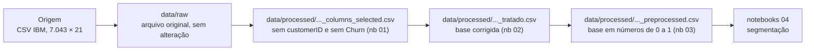

# Fonte de dados

Esta página descreve **de onde vêm os dados** do projeto: a origem, como ela está
organizada, o que cada linha representa e como refazer a carga.

## Origem

A base é a **Telco Customer Churn**, um conjunto de dados de exemplo publicado pela IBM
e muito usado em cursos e no Kaggle. Ela descreve os clientes de uma operadora de
telefonia e internet **fictícia**. Chega como um único arquivo de texto separado por
vírgulas (CSV).

```
data/raw/WA_Fn-UseC_-Telco-Customer-Churn.csv
```

O arquivo foi baixado uma vez e guardado no repositório. Não há senha, servidor ou
caminho de rede envolvido.

!!! warning "Dados sensíveis"
    A base é pública e os clientes são fictícios: não há dado pessoal real. A única coluna
    que identifica alguém é o `customerID`, um código sem ligação com pessoas reais, e ela
    não é usada na análise.

### Extração vigente

Usamos a versão original do arquivo, sem nenhuma alteração. As 21 colunas são:

| Coluna | Conteúdo |
|:---|:---|
| `customerID` | código único do cliente |
| `gender` | gênero (`Female` / `Male`) |
| `SeniorCitizen` | se é idoso (`1`) ou não (`0`) |
| `Partner` | se tem parceiro(a) (`Yes` / `No`) |
| `Dependents` | se tem dependentes (`Yes` / `No`) |
| `tenure` | quantos meses o cliente está na empresa (0 a 72) |
| `PhoneService` | se tem telefone |
| `MultipleLines` | se tem mais de uma linha (`Yes` / `No` / `No phone service`) |
| `InternetService` | tipo de internet (`DSL`, `Fiber optic` ou `No`) |
| `OnlineSecurity` | se tem segurança online (`Yes` / `No` / `No internet service`) |
| `OnlineBackup` | se tem backup online (idem) |
| `DeviceProtection` | se tem proteção do aparelho (idem) |
| `TechSupport` | se tem suporte técnico (idem) |
| `StreamingTV` | se tem TV por streaming (idem) |
| `StreamingMovies` | se tem filmes por streaming (idem) |
| `Contract` | tipo de contrato (`Month-to-month`, `One year`, `Two year`) |
| `PaperlessBilling` | se recebe a fatura só pela internet |
| `PaymentMethod` | forma de pagamento (cheque eletrônico, cheque pelo correio, transferência automática, cartão automático) |
| `MonthlyCharges` | valor da mensalidade (em dólar) |
| `TotalCharges` | total já cobrado do cliente (em dólar) |
| `Churn` | se o cliente cancelou (`Yes` / `No`) |

O dicionário completo, gerado no notebook 00, está em `data/processed/dicionario.csv`.

## Organização da origem

É um arquivo só, sem divisões (partições) nem várias tabelas.

```
data/raw/
└── WA_Fn-UseC_-Telco-Customer-Churn.csv
```

| Característica | Valor |
|:---|---:|
| Partições | 1 |
| Arquivos | 1 |
| Registros | 7.043 |
| Colunas | 21 |
| Volume na origem | ~0,98 MB |
| Período | não informado (é uma "foto" da base em um único momento) |

## Grão e conteúdo

Cada linha é um **cliente** (`customerID`).

A tabela é "achatada": tudo sobre o cliente está numa linha só. Dá para enxergar quatro
grupos de informação dentro dela: **perfil** (gênero, idoso, parceiro, dependentes),
**serviços contratados** (telefone, internet e serviços extras), **conta** (tempo de casa,
contrato, fatura e pagamento) e **valores cobrados**. A coluna `Churn` é o "rótulo", ou
seja, a resposta que um modelo supervisionado tentaria prever.

As métricas que podem ser somadas com segurança (métricas aditivas) são:

| Métrica | Descrição |
|:---|:---|
| `MonthlyCharges` | valor da mensalidade atual do cliente, em dólar |
| `TotalCharges` | soma de tudo que já foi cobrado do cliente, em dólar |

`tenure` (meses de casa) é um número, mas somar o tempo de casa de clientes diferentes não
tem significado de negócio; faz sentido olhar média ou mediana.

## Fluxo de dados no projeto



A leitura do arquivo bruto é feita nos notebooks `00-dicionario-dados` e
`01-analise-exploratoria`. A carga pode ser repetida quantas vezes quiser sem duplicar
nada (é **idempotente**): cada notebook lê o arquivo anterior e grava o seu por cima,
sempre com o mesmo resultado.

## Fontes complementares

Nenhuma. Todo o projeto usa apenas o arquivo da base Telco.

## Reprodução

```bash
# instalar o ambiente
uv sync

# abrir o JupyterLab e executar, em ordem, os notebooks 00, 01, 02 e 03
uv run invoke lab
```
