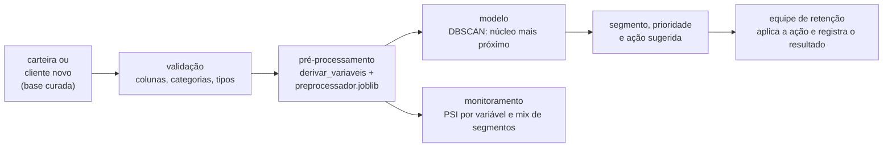

# Implementação

Um resultado só é útil quando quem decide consegue acessá-lo. Esta página descreve **como a
entrega chega ao usuário**, como ela é mantida em funcionamento e como o projeto é encerrado.

!!! warning "Situação da implantação"
    A implantação está **desenhada e demonstrada no notebook 06**, mas ainda não está em
    produção: a função de atribuição vive no notebook, `src/model/` está vazio e
    `src/deployment/app.py` ainda é o modelo em branco. A [avaliação](avaliacao.md)
    recomenda uma iteração curta antes do piloto; o que está abaixo vale para a versão
    atual dos segmentos.

## Plano de implantação

A entrega tem duas formas, porque há dois usos: uma **lista de ação em lote** para a equipe
de retenção trabalhar a carteira, e uma **função de atribuição** que classifica clientes
novos assim que entram no cadastro. A lista é um arquivo, e não um painel, porque a equipe
precisa de uma fila de clientes ordenada, e não de gráficos. A função está pronta para ser
colocada atrás de um aplicativo Streamlit (`src/deployment/app.py`).

| Entrega | Consumidor | Meio | Frequência |
|:---|:---|:---|:---|
| Lista de ação de retenção (`customerID` → segmento → prioridade → ação), 7.043 clientes | Equipe de retenção e Gerente Comercial | arquivo `reports/06-lista-acao-retencao.csv` | mensal, sobre a carteira ativa |
| Segmento, prioridade e ação de um cliente novo | Equipe de retenção e cadastro | função `segmentar` (notebook 06; aplicativo Streamlit a construir) | a cada cliente novo, sob demanda |
| Perfil dos segmentos | Diretor Comercial e Gerente Financeiro | `reports/05-perfil-segmentos.csv` | a cada re-treino |
| Monitoramento de desvio | Equipe de dados | função `monitorar` (notebook 06) | a cada lote novo |

- **Disparo da atualização:** hoje é **manual** (rodar o notebook 06). Para a lista em lote,
  o plano é um lote mensal; a premissa de infraestrutura prevê 2 atualizações diárias da
  base, que ainda não foram desenhadas (ver [Avaliação](avaliacao.md)).
- **Como a atribuição funciona:** o cliente passa pelo mesmo pré-processamento do notebook
  03 (a célula confere que a carteira inteira reproduz a saída do 03). O DBSCAN não tem
  `predict`, então o cliente recebe o segmento do **núcleo mais próximo**, se estiver a
  menos de `eps` dele; caso contrário, fica **sem segmento** (ruído).
- **Medição do efeito:** grupo de controle aleatório em cada segmento (clientes que não
  recebem a ação), para medir os cancelamentos evitados e validar as premissas financeiras
  do notebook 05.
- **Onde o artefato é publicado:** os arquivos ficam em `reports/` e `models/`, versionados
  no repositório. Não há ainda um local de publicação em rede.

**Artefatos versionados:** `models/preprocessador.joblib`, `models/model_telecom_dbscan.joblib`,
`models/selecionado.json` e `reports/05-avaliacao.json`.

## Monitoramento e manutenção

O modelo foi ajustado numa fotografia da carteira. Quando o perfil dos clientes muda (novos
planos, reajuste de preço, outra política comercial), os segmentos envelhecem. A cada lote
novo, o notebook 06 mede o **PSI** (*population stability index*) de cada variável contra a
carteira de treino e contra a distribuição dos segmentos atribuídos.

| O que monitorar | Como | Periodicidade | Ação se desviar |
|:---|:---|:---|:---|
| Desvio de cada variável de entrada | PSI da variável no lote contra a carteira de treino | a cada lote novo | PSI de 0,10 a 0,25: acompanhar no próximo lote; acima de 0,25: re-treinar |
| Mix de segmentos | PSI da distribuição dos segmentos atribuídos contra a da carteira | a cada lote novo | mesma regra de PSI |
| Clientes sem segmento | fatia de clientes classificados como ruído no lote (hoje, 0,3% da carteira) | a cada lote novo | alta persistente indica perfil novo: investigar e re-treinar |
| Entradas inválidas | erros da validação (coluna faltando, categoria inexistente, valor não numérico) | a cada lote novo | corrigir a origem do dado; o cliente é recusado em vez de cair num segmento errado |
| Valores fora da faixa da carteira | avisos da validação para `tenure` e `MonthlyCharges` fora do mínimo e do máximo de treino | a cada lote novo | se frequentes, tratar como desvio de distribuição |
| Efeito da campanha | taxa de churn do grupo tratado contra o grupo de controle, por segmento | após cada rodada de ação | revisar a ação do segmento, ou a segmentação |

??? note "O que está implementado e o que é proposta"
    - **Implementados no notebook 06:** o PSI por variável, o PSI do mix de segmentos e a
      validação das entradas.
    - **Propostas, ainda sem código:** o acompanhamento da fatia sem segmento, a leitura
      dos avisos de faixa como indicador e a comparação com o grupo de controle.

**Quando algo falha:** a validação recusa o cliente com a lista de opções válidas e **não
atribui nenhum segmento**. Enquanto não há dado novo, vale a última lista gravada em
`reports/06-lista-acao-retencao.csv`. Quem é acionado, e por qual canal, ainda **não foi
definido**: a proposta é que o aviso vá para a equipe de dados e, em falha de infraestrutura,
para o Líder de Infraestrutura.

### Retreinamento

O re-treino é **semestral** ou quando o monitoramento indicar PSI acima de 0,25. Ele refaz
a sequência 03 → 04 → 05 → 06 com a base atualizada. Para reproduzir o treino:

1. instalar o ambiente com `uv sync` (Python 3.12);
2. rodar os notebooks na ordem 02, 03, 04-0, 05 e 06, com a base nova em `data/raw/`;
3. conferir `models/selecionado.json` e `reports/05-avaliacao.json` (as sementes estão
   fixas em 42);
4. se a avaliação não aprovar o modelo, não publicar a nova lista.

## Relatório final

Ainda **não existe** um arquivo único que consolide todas as fases. O conteúdo está
distribuído nas páginas abaixo, que serão a base do relatório final.

| Artefato | Local |
|:---|:---|
| Entendimento de negócio e recursos | [Entendimento de negócio](entendimento-negocio.md) |
| Critérios de sucesso | [Critérios de sucesso](criterios-sucesso.md) |
| Dados e preparação | [Entendimento dos dados](entendimento-dados.md) e [Preparação](preparacao.md) |
| Modelagem | [Modelagem](modelagem.md) |
| Avaliação e decisão | [Avaliação](avaliacao.md) |
| Lista de ação e perfil dos segmentos | `reports/06-lista-acao-retencao.csv` e `reports/05-perfil-segmentos.csv` |
| Relatório final consolidado | a produzir (`docs/relatorio-final.md`) |
| Apresentação | a produzir (`docs/apresentacoes/`) |

## Revisão do projeto

Retrospectiva de fechamento — o que levar para o próximo projeto.

- **O que deu certo** — cadeia de notebooks com artefatos gravados e lidos pelo passo
  seguinte; regras de escolha declaradas antes de olhar o resultado; conferências de
  alinhamento entre bases; `Churn` mantido fora da modelagem; avaliação que registra as
  próprias lacunas.
- **O que poderia ter sido melhor** — os critérios de sucesso foram escritos depois da
  modelagem, e a redundância dos segmentos com `InternetService` só apareceu na avaliação;
  o código ficou nos notebooks, sem módulos em `src/`; houve retrabalho por separador de
  CSV e por textos herdados de outro projeto; a documentação ficou desencontrada entre as
  páginas.
- **O que fazer diferente** — definir e aprovar os critérios de sucesso com o negócio
  **antes** da modelagem; testar na EDA se uma única variável já reproduz os grupos; mover
  funções para `src/` e testá-las à medida que são escritas; registrar datas do projeto
  para poder medir o prazo; obter da área de negócio o valor da verba, o custo das ofertas
  e a meta de churn no início, e trabalhar na moeda do orçamento.

**Responsabilidade após o encerramento** (proposta, a confirmar com as áreas):

| Tema | Responsável |
|:---|:---|
| Manutenção do modelo e re-treino | Equipe de ciência de dados |
| Execução das ações e registro do resultado | Equipe de retenção, sob o Gerente Comercial |
| Orçamento e medição do retorno | Gerente Financeiro |
| Infraestrutura, agendamento e segurança | Líder de Infraestrutura |
| Acesso aos dados | Líder de Infraestrutura (segurança da informação) |
| Ponto de contato do projeto | Gerente de Projetos |
