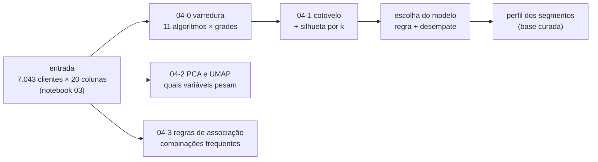

# Modelagem dos dados

Esta página descreve **o desenho do experimento de modelagem**: qual problema o modelo
resolve, sobre que unidade de análise ele opera, quais variáveis entram, qual técnica foi
escolhida e como o resultado é avaliado.

!!! note "Quais objetivos exigem modelagem"
    Dos [critérios de sucesso](criterios-sucesso.md), exigem modelo os objetivos **1**
    (segmentação) e **3** (modelo que atribui o segmento). Os objetivos 2, 4 e 5 usam o
    resultado do modelo, mas são resolvidos com tabelas de perfil e de risco na
    [avaliação](avaliacao.md) e na [implementação](implementacao.md).

    > **Comentário:** a dica original pedia para declarar isso no início; fiz a ligação
    > com os objetivos que escrevi na etapa anterior.

## Problema

Dividir os 7.043 clientes da operadora em **no máximo 5 grupos parecidos**, sem usar a
informação de quem cancelou, para que cada grupo receba uma ação de retenção própria dentro
da verba disponível. Corresponde aos objetivos **1** e **3** dos
[critérios de sucesso](criterios-sucesso.md).

A modelagem está em quatro notebooks, todos lendo a mesma entrada (a base do notebook 03):

| Notebook | Papel |
|:---|:---|
| `04-0-modelagem-cluster` | varredura de 11 algoritmos de agrupamento e escolha do modelo |
| `04-1-modelagem-cotovelo` | cotovelo e silhueta de 8 algoritmos, para justificar o número de grupos |
| `04-2-modelagem-reducao` | PCA e UMAP: quais variáveis mais pesam na estrutura dos dados |
| `04-3-modelagem-associacao` | regras de associação (Apriori, Eclat e FP-Growth) entre características |

## Unidade de análise

Um registro por **cliente** (`data/processed/Telcon-Customer-Churn_preprocessed.csv`:
7.043 linhas × 20 colunas, tudo entre 0 e 1).

A pergunta de negócio é sobre o cliente (qual ação de retenção ele recebe), e a base já tem
uma linha por cliente. Agrupar por outra unidade, como o serviço contratado, repetiria o
mesmo cliente em vários grupos e não permitiria atribuir uma única ação a cada um.

## Variáveis

| Critério pede | Variável usada | Observação |
|:---|:---|:---|
| Serviços contratados | `PhoneService_Yes`, `MultipleLines_Yes`, `InternetService_*`, `StreamingTV_Yes`, `StreamingMovies_Yes` | internet em 3 colunas (DSL, fibra, nenhuma) |
| Serviços contratados | `ServicosProtecao` | **derivada**: nº de serviços de proteção (segurança, backup, proteção do aparelho, suporte), de 0 a 4 |
| Tipo de contrato | `Contract_*` | mensal, anual e dois anos |
| Forma de pagamento | `PaymentMethod_*`, `PaperlessBilling_Yes` | pagamentos automáticos unidos em `Automatic`; sobram cheque eletrônico e cheque pelo correio |
| Tempo de casa e mensalidade | `tenure`, `MonthlyCharges` | únicas variáveis contínuas |
| Perfil | `SeniorCitizen_Yes`, `Partner_Yes`, `Dependents_Yes` | indicadores Yes/No |
| — | *(fora do modelo)* `gender`, `TotalCharges`, `customerID`, `Churn` | ver abaixo |

**Variáveis derivadas.** `ServicosProtecao` resume 4 colunas em uma contagem, porque a EDA
mostrou que ter segurança e suporte reduz o cancelamento (15% contra 41–42%). Pagamento
automático une cartão e débito, que se comportam do mesmo jeito.

### Pré-processamento

Feito no notebook 03 (detalhes em [Preparação](preparacao.md)):

- `TotalCharges` retirada: repete `tenure` × `MonthlyCharges`;
- Yes/No viram uma coluna 0/1; colunas de 3 categorias viram uma coluna 0/1 por categoria
  (*one-hot*);
- `tenure` e `MonthlyCharges` na escala de 0 a 1 (MinMax), para nenhuma pesar mais que as
  outras;
- sem vazios nem valores extremos a tratar; não há balanceamento, porque não há classe-alvo.

O one-hot deixa **3 direções sem variância** entre as 20 colunas (as colunas de uma mesma
variável somam 1). Elas ficam de fora do cálculo de Mahalanobis (17 mantidas).

## Técnica

A base é **mista**: quase tudo é indicador 0/1 (categorias) e só duas colunas são
contínuas. Por isso o notebook 04-0 não aposta em um único algoritmo: testa **11**, de
cinco famílias, sempre na mesma base e com a mesma régua de qualidade.

| Família | Algoritmos |
|:---|:---|
| Centroides | k-means, mini batch, bisecting, k-means Manhattan, k-means Mahalanobis, k-medoids |
| Hierárquica | Birch, Ward |
| Probabilística | mistura gaussiana (GMM) |
| Densidade | Mean Shift, DBSCAN |

- **Onde cada etapa é ajustada:** tudo na **base completa** (7.043 clientes); não há
  amostra nem divisão treino/teste. Os rótulos de cada configuração são gerados sobre todos
  os clientes.
- **04-0:** cada algoritmo varre uma grade de hiperparâmetros (k = 2, 3, 4, 5, 6 e 8, mais
  parâmetros próprios). Mean Shift e DBSCAN têm a escala (largura da janela e raio `eps`)
  tirada dos próprios dados. O vencedor é salvo em `models/` e os rótulos em
  `data/processed/segmentos.csv`.
- **04-1:** treina cada algoritmo para k = 1 a 10 e traça duas curvas: o **peso** (custo que
  o algoritmo minimiza, sempre cai) e a **silhueta** (contraprova). Mostra o cotovelo do
  peso.
- **04-2:** PCA mantém os componentes que somam 90% da variância (**11 componentes**) e UMAP
  reduz a 5 dimensões. Mostram quais variáveis mais pesam; não geram segmentos.
- **04-3:** cada cliente vira uma "cesta" de características (numéricas cortadas em tercis).
  Apriori, Eclat e FP-Growth encontram os **mesmos** conjuntos frequentes (o notebook
  confere); depois saem regras "se A, então B".

## Avaliação do modelo

| Métrica | Leitura |
|:---|:---|
| Silhueta (−1 a 1) | **maior é melhor**: o cliente está mais perto do próprio grupo do que do vizinho. É a régua comum entre algoritmos (euclidiana) |
| Peso / inércia | **menor é melhor**, mas sempre cai quando k aumenta; serve para achar o **cotovelo**, onde um grupo a mais deixa de compensar |
| Tamanho do maior grupo | **menor é melhor** para segmentar: acima de 90% da carteira o grupo só isola exceções |
| Ruído (DBSCAN) | **menor é melhor**: fatia de clientes sem grupo, com teto de 20% |
| Suporte, confiança e lift (04-3) | suporte: fração com A e B juntos; confiança: dos que têm A, quantos têm B; lift: quantas vezes A aumenta a chance de B (1 = independentes). Regras fortes: confiança ≥ 60% e lift ≥ 1,2 |
| Variância explicada (04-2) | **maior é melhor**: quanto da variação o PCA mantém (alvo de 90%) |

**Desenho do experimento.**

- **Divisão treino/teste e validação cruzada:** não há. O agrupamento é não supervisionado,
  tudo é medido na base completa e Ward e DBSCAN nem classificam clientes novos.
- **Faixa de hiperparâmetros:** k de 2 a 8 (04-0) e de 1 a 10 (04-1); 77 configurações
  treinadas no 04-0.
- **Critério de escolha (regra declarada antes de olhar o resultado):** (1) número de
  grupos dentro da faixa operável; (2) ruído de até 20% e nenhum grupo com mais de 90% da
  carteira; (3) entre os que sobram, vence a maior silhueta comum. Passaram **26 de 77**
  configurações.
- **Resultado:** o **DBSCAN** (`eps = 1,419`, 3 grupos) vence com silhueta **0,187**; o
  K-Means com k = 3 fica com 0,186 (empate técnico).

!!! warning "Ressalva de métrica"
    - **Silhueta baixa em todos os algoritmos** (a melhor de cada um fica entre 0,13 e 0,19,
      abaixo do mínimo de 0,25 definido no 04-1). Os perfis de clientes formam um contínuo,
      sem ilhas separadas. O vencedor sai **com a ressalva de que a estrutura é fraca**.
    - **A silhueta de cada algoritmo só vale na própria régua.** O K-Means Manhattan chega a
      0,237 (k = 6), mas cai para 0,147 na régua comum e k = 6 está fora da faixa.
    - **Silhueta alta do DBSCAN é artefato:** 0,917 com 45 grupos acontece porque 86,2% dos
      clientes viram ruído e a silhueta só olha os 13,8% restantes. A regra do ruído
      descarta essa configuração.
    - **Desempate:** o DBSCAN e o K-Means formam segmentos quase idênticos. O K-Means
      rotula todos os clientes e tem `predict`, o que pesa a favor dele na operação (ver
      objetivo 3 dos critérios de sucesso).

## Interpretação do resultado

Cada cliente recebe um segmento e o **perfil do segmento** é descrito em unidades de
negócio, usando a base curada (`tratado.csv`) e não a escalonada: número de clientes,
mensalidade mediana, nº de serviços de proteção, tempo de casa (mediana) e % em contrato
mensal.

**Segmentos do modelo selecionado (DBSCAN, 7.043 clientes):**

| Segmento | Clientes | Participação |
|:-:|--:|--:|
| 1 | 3.084 | 43,8% |
| 0 | 2.410 | 34,2% |
| 2 | 1.525 | 21,7% |
| −1 (ruído) | 24 | 0,3% |

- **Cotovelo × silhueta:** o cotovelo do peso cai em k = 4 (K-Means, Manhattan,
  Mahalanobis, GMM e Ward) e em k = 3 (K-Medoids), enquanto a silhueta do K-Means é maior em
  k = 3 (0,186) do que em k = 4 (0,183). **A escolha entre 3 e 4 grupos é decisão de
  negócio**; a diferença de qualidade é pequena.
- **Redução (04-2):** o PCA e o UMAP indicam quais variáveis mais pesam. Atenção: relevância
  na redução não é relevância para o negócio, pois uma coluna pesa por **variar muito**,
  não por separar segmentos. O PCA tende a favorecer one-hot equilibrados.
- **Regras (04-3):** foram salvas **168 regras fortes**. A de maior lift é
  `InternetService=No → MonthlyCharges=baixo + ServicosProtecao=baixo` (confiança 100%,
  lift 3,1, suporte 21,7%), que descreve o grupo sem internet. Regras com lift alto e
  suporte baixo são nichos; associação não é causa.
- **Nomeação dos grupos:** não há nomeação automática. Os nomes das ações de retenção serão
  dados na [avaliação](avaliacao.md), a partir do perfil (por exemplo, mensal + fibra +
  cheque eletrônico, que a EDA mostrou com 60,4% de cancelamento).

## Saídas

| Arquivo | Conteúdo |
|:---|:---|
| `models/model_telecom_dbscan.joblib` | modelo selecionado pelo 04-0 (DBSCAN, `eps = 1,42`, 3 grupos) |
| `models/selecionado.json` | resumo do vencedor (modelo, parâmetros, grupos, silhueta), lido pelo 05 |
| `models/preprocessador.joblib` | pré-processador do notebook 03, reutilizado para novos clientes |
| `data/processed/segmentos.csv` | segmento de cada um dos 7.043 clientes (−1 = ruído) |
| `data/processed/Telcon-Customer-Churn_pca.csv` | base reduzida pelo PCA (7.043 × 11) |
| `data/processed/Telcon-Customer-Churn_umap.csv` | base reduzida pelo UMAP (7.043 × 5) |
| `data/processed/regras_associacao.csv` | 168 regras fortes de associação |
| `models/model_bonus_telecom_k_means.joblib` | K-Means do notebook bônus (07), alternativa com `predict` |

