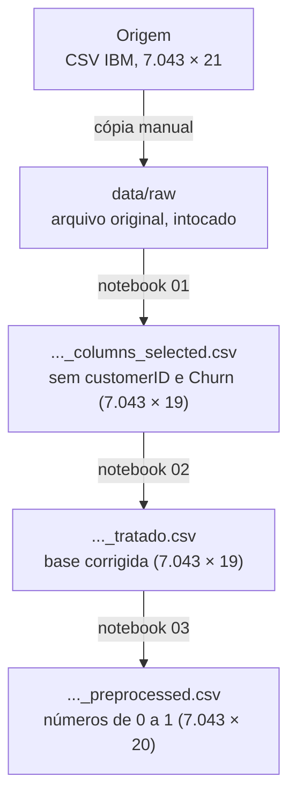

# Preparação dos dados

Esta página descreve **o que foi feito com os dados** entre a origem e a modelagem: em que
etapas eles passam, que correções foram aplicadas e como conferimos que nada se perdeu.

## Arquitetura em camadas

Os dados passam por "camadas". Cada camada é um arquivo, e cada notebook lê a camada
anterior e grava a próxima. O arquivo original **nunca é alterado**.



| Camada | Diretório | Papel |
|:---|:---|:---|
| Bruta | `data/raw/WA_Fn-UseC_-Telco-Customer-Churn.csv` | cópia original, nunca editada |
| Selecionada | `data/processed/Telcon-Customer-Churn_columns_selected.csv` | sem `customerID` e sem `Churn` (notebook 01) |
| Curada | `data/processed/Telcon-Customer-Churn_tratado.csv` | correções de qualidade, ainda em "linguagem de negócio" (notebook 02) |
| Pré-processada | `data/processed/Telcon-Customer-Churn_preprocessed.csv` | só números de 0 a 1, pronta para o algoritmo (notebook 03) |

Todos os arquivos mantêm **a mesma ordem de linhas** da base original. Como o
`customerID` foi retirado, é a posição da linha que liga cada cliente entre as camadas.

## Materialização da camada bruta

O arquivo CSV foi baixado uma vez e salvo em `data/raw` exatamente como veio. Não há
divisão em partes nem conversão de formato, porque a base é pequena (menos de 1 MB).

```
data/raw/WA_Fn-UseC_-Telco-Customer-Churn.csv
```

O processo pode ser repetido quantas vezes quiser (é **idempotente**): cada notebook
sobrescreve o seu arquivo de saída e sempre chega no mesmo resultado. O notebook 02 confere
no final que o número de clientes não mudou.

## Regras de limpeza

As correções estão no notebook `02-ajustes-dados.ipynb`, aplicadas em sequência numa
única execução. Cada uma é registrada automaticamente em `docs/tabelas/ajustes-dados.csv`
com o motivo e quantos registros foram alterados.

| # | Regra | Motivo | Registros |
|:-:|:---|:---|--:|
| 1 | Retirar `customerID` e `Churn` (notebook 01) | `customerID` é só um código; `Churn` é o rótulo e o projeto é não supervisionado | — |
| 2 | Manter as linhas repetidas | são clientes diferentes com 1 mês de casa e o mesmo pacote, não erro | 0 |
| 3 | `TotalCharges` vazio → `0` | os 11 clientes têm `tenure = 0`: ainda não foram cobrados | 11 |
| 4 | `SeniorCitizen` `0/1` → `No/Yes` | padronizar com as outras colunas de sim/não | 7.043 |
| 5 | `No internet service` / `No phone service` → `No` | repetem o que `InternetService` / `PhoneService` já dizem | 2.208 |
| 6 | Colunas de texto viram o tipo `category` | economiza memória e deixa claro que são categorias | — |

Na sequência, o notebook `03-preparacao.ipynb` prepara a base para o algoritmo de
agrupamento (K-Means), que compara clientes medindo a **distância** entre eles. As
decisões ficam em `docs/tabelas/preparacao-colunas.csv`:

| # | Regra | Motivo |
|:-:|:---|:---|
| 7 | Retirar `TotalCharges` | é quase `tenure` × `MonthlyCharges` (correlação 0,89 com `tenure`); contaria o tempo de casa duas vezes |
| 8 | Retirar `gender` | não tem relação com nenhuma outra coluna (V de Cramér máximo 0,02); só atrapalharia a formação dos grupos |
| 9 | Criar `ServicosProtecao` (0 a 4) e retirar as 4 colunas de proteção | os quatro serviços andam juntos; em vez de pesarem 4 vezes, pesam 1 |
| 10 | Juntar os dois pagamentos automáticos em `Automatic` | perfis praticamente iguais; separados não diferenciam nada |
| 11 | Colunas `Yes/No` viram **uma** coluna `0/1` | o algoritmo só entende números |
| 12 | Colunas com 3 categorias (`InternetService`, `Contract`, `PaymentMethod`) viram uma coluna `0/1` **para cada categoria** (one-hot) | transformar em 1, 2, 3 inventaria uma ordem que não existe |
| 13 | `tenure`, `MonthlyCharges` e `ServicosProtecao` vão para a escala de 0 a 1 (`MinMaxScaler`) | sem isso, uma diferença de 50 dólares pesaria 50 vezes mais que ter ou não um serviço |

As regras 9 e 10 ficam na função `derivar_variaveis` do notebook 03, e as regras 11 a 13
num pré-processador salvo em `models/preprocessador.joblib`. Assim um cliente novo pode
passar **exatamente** pela mesma transformação na implantação.

O dicionário de dados fica em `data/processed/dicionario.csv` (gerado no notebook 00). Ele
descreve as colunas da base bruta, mas ainda **não** registra as colunas criadas
(`ServicosProtecao`) nem as transformações feitas em cada uma.

## Conferências

Validações feitas antes de seguir para a modelagem:

- **contagem de linhas** — as 7.043 linhas da base bruta chegam inteiras em todas as
  camadas (`assert` no fim dos notebooks 02 e 03);
- **vazios** — nenhuma célula vazia na base curada nem na pré-processada;
- **efeito da limpeza** — as colunas de serviço passam de 3 para 2 categorias (`Yes/No`), e
  `PaymentMethod` de 4 para 3; o notebook 02 prova antes que cada `No internet service`
  corresponde exatamente a `InternetService = "No"`;
- **faixa de valores** — todas as 20 colunas da base pré-processada estão entre 0 e 1;
- **proporções** — a média de cada coluna `0/1` é a proporção de clientes com aquela
  característica (por exemplo, 55% com contrato mensal), e bate com a EDA.

## Agregados

Não foram criados agregados (tabelas resumidas). A segmentação trabalha com **um registro
por cliente**, que já é o grão da base.

## Tratamento de outliers

Não há valores extremos a tratar. Pelo critério IQR, `tenure`, `MonthlyCharges` e
`TotalCharges` não têm nenhum valor fora dos limites. O único "outlier" apontado foi
`SeniorCitizen`, que é uma coluna de sim/não guardada como número: era um falso alarme,
resolvido ao convertê-la para `Yes/No`.

A única variável numérica com distribuição bem torta (assimetria de 0,96) era
`TotalCharges`. Como ela saiu do modelo, não foi preciso aplicar transformação de
logaritmo.

## Reprodução

```bash
uv sync           # instala o ambiente
uv run invoke lab # abre o JupyterLab; executar os notebooks 00, 01, 02 e 03, nessa ordem
```
