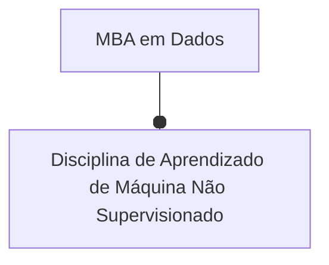
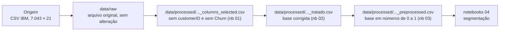
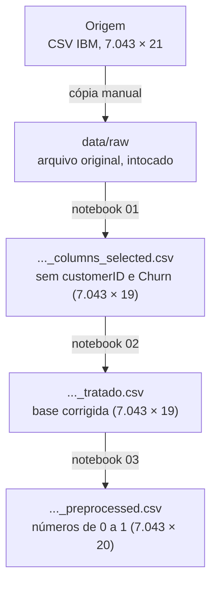

# O que foi escrito na documentação do projeto

Gerado em 30/10/2026. Reúne, num arquivo só, o texto que foi colocado nos arquivos `.md` da
pasta `projeto-retencao-clientes-telecom/docs`, com base nos notebooks 00 a 03.

| Arquivo | Situação |
|:---|:---|
| `index.md` | preenchido |
| `status.md` | preenchido |
| `fonte-dados.md` | preenchido |
| `entendimento-dados.md` | preenchido |
| `analise-exploratoria.md` | preenchido |
| `preparacao.md` | preenchido |
| `entendimento-negocio.md` | preenchido em parte (só os trechos alterados aparecem abaixo) |
| `criterios-sucesso.md`, `modelagem.md`, `avaliacao.md`, `implementacao.md` | não alterados |

Os títulos de cada página foram rebaixados um nível para caber neste arquivo.


---

# Arquivo `docs/index.md`

## Retenção de clientes Telecom

### Introdução

Empresas de telefonia e internet perdem clientes todos os meses. Quando um cliente cancela
o contrato, chamamos isso de **churn** (cancelamento). Conquistar um cliente novo costuma
custar bem mais caro do que manter quem já está na base, então entender **quem são os
clientes** e **quais perfis têm mais chance de sair** ajuda a empresa a agir antes do
cancelamento.

Este projeto usa a base pública *Telco Customer Churn* (7.043 clientes de uma operadora
fictícia) para **dividir os clientes em grupos parecidos** (segmentos). A ideia é que cada
grupo tenha um perfil claro (tipo de contrato, serviços contratados, forma de pagamento,
tempo de casa), para que a área de retenção possa criar ações diferentes para cada um.

### Dados do projeto

A base tem **uma linha por cliente** e 21 colunas: dados pessoais simples (idoso, tem
parceiro, tem dependentes), serviços contratados (telefone, internet, segurança online,
streaming etc.), informações do contrato (tempo de casa, tipo de contrato, forma de
pagamento) e valores cobrados (mensalidade e total já pago). Também traz a coluna `Churn`,
que diz se o cliente cancelou ou não.

Detalhes em [Fonte dos dados](fonte-dados.md) e [Entendimento dos dados](entendimento-dados.md).

#### Levantamento inicial

!!! info "Tipo do projeto"
    - [x] Análise exploratória
    - [ ] Modelo preditivo
    - [ ] Modelo de classificação
    - [x] Modelo de agrupamento
    - [ ] Detecção de anomalias

#### Nível de acesso

!!! warning "Confidencialidade"
    - [x] Público
    - [ ] Interno (toda a organização)
    - [ ] Restrito (apenas a área requisitante)

    A base é pública (disponibilizada pela IBM como exemplo) e não identifica pessoas reais.

#### Objetivos de negócio

!!! quote ""
    Separar a carteira de clientes em **segmentos com perfis diferentes**, usando
    aprendizado **não supervisionado** (o algoritmo encontra os grupos sozinho, sem saber
    quem cancelou), para que a área de retenção consiga entender cada grupo e planejar
    ações específicas para os perfis com maior risco de cancelamento.

### Sobre o projeto

#### Histórico do documento

| Data       | Versão | Descrição                                                        | Autor             |
| :--------- | :----- | :--------------------------------------------------------------- | :---------------- |
| 30/10/2026 | 1.0    | Preenchimento com o que foi consolidado nos notebooks 00 a 03     | Equipe do projeto |

#### Dados do solicitante



| Nome                                                   | Cargo / Função          | E-mail |
| :----------------------------------------------------- | :---------------------- | :----- |
| <span style="color:red">**Nome do professor**</span>   | Professor da disciplina | —      |

#### Dados da equipe técnica

| Nome                   | Cargo / Função      | E-mail |
| :--------------------- | :------------------ | :----- |
| Stevens Castro         | Integrante do grupo | —      |
| Tevin                  | Integrante do grupo | —      |
| Thierry Pereira Canoco | Integrante do grupo | —      |

---

# Arquivo `docs/status.md`

## Status do projeto

Situação em 30/10/2026: fases de entendimento e preparação dos dados concluídas
(notebooks 00 a 03). A modelagem (notebooks 04 em diante) ainda está em andamento.

???+ abstract "Fase 1: Preparação do ambiente"
    - [x] Criar repositório (GitHub: `stevens-castro/projeto-retencao-clientes-telecom`)
    - [x] Instalar ferramentas do projeto (`uv sync`)
    

???+ abstract "Fase 2: Entendimento de negócio"
    - [ ] Elaborar projeto inicial
    - [ ] Produzir relatório mineração dos dados

???+ abstract "Fase 3: Entendimento dos dados"    
    - [x] Gerar conjunto de dados (dicionário de dados — notebook 00)
    - [x] Produzir relatório qualidade dos dados (valores ausentes e discrepantes — notebook 01)
    - [x] Realizar descrição dos dados
    - [x] Realizar análise exploratória (notebook 01)
    - [x] Produzir relatório do entendimento dos dados ([Entendimento dos dados](entendimento-dados.md))

???+ abstract "Fase 4: Preparação dos dados"
    - [x] Gerar script de limpeza dos dados (notebook 02)
    - [x] Gerar conjunto de dados processado (notebooks 02 e 03)
    - [x] Produzir relatório preparação dos dados ([Preparação dos dados](preparacao.md))

???+ abstract "Fase 5: Modelagem"
    - [ ] Gerar desenho do experimento da modelagem
    - [ ] Gerar script da modelagem
    - [ ] Produzir relatório com os resultados

???+ abstract "Fase 6: Avaliação"
    - [ ] Produzir relatório da avaliação dos resultados
    - [ ] Produzir relatório das próximas etapas

???+ abstract "Fase 7: Implementação"
    - [ ] Gerar desenho da implementação
    - [ ] Desenvolver script da implementação
    - [ ] Produzir relatório de monitoramento e manutenção dos modelos
    - [ ] Produzir relatório final contendo todas as fases anteriores

---

# Arquivo `docs/fonte-dados.md`

## Fonte de dados

Esta página descreve **de onde vêm os dados** do projeto: a origem, como ela está
organizada, o que cada linha representa e como refazer a carga.

### Origem

A base é a **Telco Customer Churn**, um conjunto de dados de exemplo publicado pela IBM
e muito usado em cursos e no Kaggle. Ela descreve os clientes de uma operadora de
telefonia e internet **fictícia**. Chega como um único arquivo de texto separado por
vírgulas (CSV).

```
data/raw/WA_Fn-UseC_-Telco-Customer-Churn.csv
```

O arquivo foi baixado uma vez e guardado no repositório. Não há senha, servidor ou
caminho de rede envolvido.

!!! warning "Dados sensíveis"
    A base é pública e os clientes são fictícios: não há dado pessoal real. A única coluna
    que identifica alguém é o `customerID`, um código sem ligação com pessoas reais, e ela
    não é usada na análise.

#### Extração vigente

Usamos a versão original do arquivo, sem nenhuma alteração. As 21 colunas são:

| Coluna | Conteúdo |
|:---|:---|
| `customerID` | código único do cliente |
| `gender` | gênero (`Female` / `Male`) |
| `SeniorCitizen` | se é idoso (`1`) ou não (`0`) |
| `Partner` | se tem parceiro(a) (`Yes` / `No`) |
| `Dependents` | se tem dependentes (`Yes` / `No`) |
| `tenure` | quantos meses o cliente está na empresa (0 a 72) |
| `PhoneService` | se tem telefone |
| `MultipleLines` | se tem mais de uma linha (`Yes` / `No` / `No phone service`) |
| `InternetService` | tipo de internet (`DSL`, `Fiber optic` ou `No`) |
| `OnlineSecurity` | se tem segurança online (`Yes` / `No` / `No internet service`) |
| `OnlineBackup` | se tem backup online (idem) |
| `DeviceProtection` | se tem proteção do aparelho (idem) |
| `TechSupport` | se tem suporte técnico (idem) |
| `StreamingTV` | se tem TV por streaming (idem) |
| `StreamingMovies` | se tem filmes por streaming (idem) |
| `Contract` | tipo de contrato (`Month-to-month`, `One year`, `Two year`) |
| `PaperlessBilling` | se recebe a fatura só pela internet |
| `PaymentMethod` | forma de pagamento (cheque eletrônico, cheque pelo correio, transferência automática, cartão automático) |
| `MonthlyCharges` | valor da mensalidade (em dólar) |
| `TotalCharges` | total já cobrado do cliente (em dólar) |
| `Churn` | se o cliente cancelou (`Yes` / `No`) |

O dicionário completo, gerado no notebook 00, está em `data/processed/dicionario.csv`.

### Organização da origem

É um arquivo só, sem divisões (partições) nem várias tabelas.

```
data/raw/
└── WA_Fn-UseC_-Telco-Customer-Churn.csv
```

| Característica | Valor |
|:---|---:|
| Partições | 1 |
| Arquivos | 1 |
| Registros | 7.043 |
| Colunas | 21 |
| Volume na origem | ~0,98 MB |
| Período | não informado (é uma "foto" da base em um único momento) |

### Grão e conteúdo

Cada linha é um **cliente** (`customerID`).

A tabela é "achatada": tudo sobre o cliente está numa linha só. Dá para enxergar quatro
grupos de informação dentro dela: **perfil** (gênero, idoso, parceiro, dependentes),
**serviços contratados** (telefone, internet e serviços extras), **conta** (tempo de casa,
contrato, fatura e pagamento) e **valores cobrados**. A coluna `Churn` é o "rótulo", ou
seja, a resposta que um modelo supervisionado tentaria prever.

As métricas que podem ser somadas com segurança (métricas aditivas) são:

| Métrica | Descrição |
|:---|:---|
| `MonthlyCharges` | valor da mensalidade atual do cliente, em dólar |
| `TotalCharges` | soma de tudo que já foi cobrado do cliente, em dólar |

`tenure` (meses de casa) é um número, mas somar o tempo de casa de clientes diferentes não
tem significado de negócio; faz sentido olhar média ou mediana.

### Fluxo de dados no projeto



A leitura do arquivo bruto é feita nos notebooks `00-dicionario-dados` e
`01-analise-exploratoria`. A carga pode ser repetida quantas vezes quiser sem duplicar
nada (é **idempotente**): cada notebook lê o arquivo anterior e grava o seu por cima,
sempre com o mesmo resultado.

### Fontes complementares

Nenhuma. Todo o projeto usa apenas o arquivo da base Telco.

### Reprodução

```bash
# instalar o ambiente
uv sync

# abrir o JupyterLab e executar, em ordem, os notebooks 00, 01, 02 e 03
uv run invoke lab
```

---

# Arquivo `docs/entendimento-dados.md`

## Entendimento dos dados

Esta página responde a três perguntas sobre o conjunto de dados: **o que existe**, **em que
qualidade** e **o que isso impede ou permite** dentro dos objetivos do projeto.

### Dados iniciais

Os dados vêm do arquivo `data/raw/WA_Fn-UseC_-Telco-Customer-Churn.csv` (veja
[Fonte dos dados](fonte-dados.md)). A descrição das colunas foi feita no notebook
`00-dicionario-dados.ipynb` e a análise de qualidade e a exploração no notebook
`01-analise-exploratoria.ipynb`.

### Descrição dos dados

#### Grão

Cada linha é um **cliente** (`customerID`). Não há cliente repetido: os 7.043 códigos são
todos diferentes.

A tabela é **achatada**: tudo sobre o cliente está numa linha só, sem tabelas auxiliares.
Dentro dela existem quatro grupos de informação (perfil, serviços, conta e valores), mais o
rótulo `Churn`.

#### Grupos de colunas

| Dimensão | Exemplos de colunas |
|:---|:---|
| Perfil do cliente | `gender`, `SeniorCitizen`, `Partner`, `Dependents` |
| Serviços de telefone | `PhoneService`, `MultipleLines` |
| Serviços de internet | `InternetService`, `OnlineSecurity`, `OnlineBackup`, `DeviceProtection`, `TechSupport`, `StreamingTV`, `StreamingMovies` |
| Conta e contrato | `tenure`, `Contract`, `PaperlessBilling`, `PaymentMethod` |
| Métricas (valores) | `MonthlyCharges`, `TotalCharges` |
| Rótulo (fora do modelo) | `Churn` |

Por tipo, o dicionário classificou as colunas assim: **17 nominais** (categorias sem
ordem, como `Yes/No`), **2 discretas** (números inteiros: `SeniorCitizen` e `tenure`) e
**2 contínuas** (valores com casas decimais: `MonthlyCharges` e `TotalCharges`). Não há
colunas de data nem colunas ordinais (categorias com ordem, como "baixo/médio/alto").

#### Cobertura frente aos critérios de sucesso

<span style="color:red">**Preencher depois que os objetivos forem definidos em
[Critérios de sucesso](criterios-sucesso.md).**</span> Adiantando o que já se sabe: os dados
**permitem** descrever o perfil, os serviços e o contrato de cada cliente (base para a
segmentação), mas **não permitem** acompanhar o cliente ao longo do tempo (veja
[Limitações](#limitacoes)).

### Qualidade dos dados

No geral a base está bem limpa: quase não há células vazias, nenhum cliente repetido e
nenhum valor absurdo. Os pontos de atenção estão abaixo.

#### Valores sentinela

"Sentinela" é um valor que **parece** um dado, mas na verdade quer dizer "sem informação"
ou "não se aplica". Nesta base, aparecem três casos:

| Sentinela | Significado |
|:---|:---|
| `" "` (espaço em branco) em `TotalCharges` | cliente que ainda não recebeu nenhuma cobrança (11 clientes, todos com `tenure = 0`) |
| `No internet service` nos 6 serviços de internet | o cliente não tem internet; repete o que `InternetService = "No"` já diz (1.526 clientes) |
| `No phone service` em `MultipleLines` | o cliente não tem telefone; repete o que `PhoneService = "No"` já diz (682 clientes) |

As correções estão no notebook `02-ajustes-dados.ipynb`: o espaço em branco virou `0` e as
duas categorias "No ... service" viraram `No`. Nenhuma informação se perde, porque a
ausência do serviço continua registrada em `InternetService` e `PhoneService`.

#### Achados que mudam a análise

1. **`TotalCharges` chegou como texto e com 11 vazios.** Os 11 clientes vazios têm
   `tenure = 0`: entraram no mês da extração e ainda não pagaram nada. Por isso a correção
   é colocar **0**, e não apagar a linha nem usar a média. (A conta confirma:
   `TotalCharges` ≈ `tenure` × `MonthlyCharges`, com razão mediana de 1,00.)
2. **`TotalCharges` repete informação.** Como ela é praticamente tempo de casa ×
   mensalidade, tem correlação de 0,89 com `tenure` (Spearman). Se entrasse no modelo, o
   tempo de casa seria contado duas vezes. Por isso ela **fica fora** da segmentação.
3. **Categorias repetidas nos serviços.** `No internet service` aparece em 6 colunas e
   `No phone service` em uma. Sem correção, a mesma informação ("não tem internet")
   entraria 7 vezes e deixaria os serviços artificialmente parecidos entre si.
4. **`SeniorCitizen` é o único "Sim/Não" guardado como número (0/1).** Por isso a análise
   de valores discrepantes o apontou como "outlier", o que é falso: só 16% dos clientes são
   idosos. Ele foi convertido para `Yes/No`, como as outras colunas.
5. **Linhas iguais não são erro.** Sem o `customerID`, 40 linhas repetem outra (73 linhas
   envolvidas). Todas são de clientes com 1 mês de casa e o mesmo pacote básico: são
   clientes **diferentes** com o mesmo perfil, então **nada foi apagado**.
6. **`gender` não se relaciona com nada.** A associação com as outras colunas é
   praticamente zero (V de Cramér máximo de 0,02). Ela **fica fora** da segmentação para
   não criar grupos de "homens" e "mulheres" que não diferem em mais nada.
7. **Valores extremos: nenhum.** `tenure`, `MonthlyCharges` e `TotalCharges` não têm nenhum
   valor fora dos limites do critério IQR (veja [Análise exploratória](analise-exploratoria.md)).

### Dimensões-chave

Duas dimensões novas foram criadas na preparação (notebook 03), a partir das colunas
existentes. Elas não usam `Churn` em nenhum momento.

**`ServicosProtecao`**: os quatro serviços de proteção (segurança online, backup, proteção
do aparelho e suporte técnico) andam juntos — quem contrata um costuma contratar outro.
Em vez de quatro colunas, o modelo recebe **uma** contagem de quantos o cliente tem.

| Valor | Descrição | Regra de derivação |
|:---|:---|:---|
| `0` a `4` | quantos serviços de proteção o cliente contrata | soma dos `Yes` em `OnlineSecurity`, `OnlineBackup`, `DeviceProtection` e `TechSupport` |

**`PaymentMethod` agrupada**: as duas formas automáticas de pagamento têm perfis
praticamente iguais (tempo de casa mediano de 48 e 47 meses, mensalidade mediana de 73),
então viraram uma categoria só.

| Valor | Descrição | Regra de derivação |
|:---|:---|:---|
| `Automatic` | o cliente não precisa fazer nada para pagar | `Bank transfer (automatic)` ou `Credit card (automatic)` |
| `Electronic check` | paga por cheque eletrônico | sem mudança |
| `Mailed check` | paga por cheque pelo correio | sem mudança |

### Limitações

O que os dados **não** permitem responder:

- **Não há data.** A base é uma "foto" de um único momento. Não dá para saber quando o
  cliente cancelou, nem ver se o comportamento mudou com o tempo. O único dado de tempo é
  `tenure` (meses de casa).
- **Não há dados de uso nem de atendimento.** Não sabemos quanto o cliente usa a internet,
  quantas vezes ligou reclamando ou se recebeu alguma oferta. Esses são motivos comuns de
  cancelamento que ficam de fora.
- **Os dados são fictícios.** Servem para aprender o método, mas os números não
  representam uma operadora real.
- **Uso do `Churn` em aberto.** Pela decisão atual do grupo, `Churn` foi retirada da base
  ao final do notebook 01 e não participa de nenhuma etapa seguinte. Isso impede, por
  enquanto, de responder "qual segmento cancela mais?". A discussão está registrada em
  [decisão sobre o Churn](informacoes_complementares/decisao-churn.md).

---

# Arquivo `docs/analise-exploratoria.md`

## Análise exploratória

Esta página resume **como** a análise exploratória (EDA) foi feita: quais notebooks existem,
o que cada um responde e as decisões que valem para todos. Os resultados ficam nas figuras
de `docs/imagens/eda/` e nas tabelas de `docs/tabelas/`.

### Mapa dos notebooks

| Notebook | Objetivo | Recorte | Saída principal |
|:---|:-:|:---|:---|
| `00-dicionario-dados.ipynb` | — | base bruta completa (7.043 × 21) | `data/processed/dicionario.csv` (nome, descrição, exemplos e tipo de cada coluna) |
| `01-analise-exploratoria.ipynb` | — | base bruta sem `customerID` (7.043 × 20) | figuras em `docs/imagens/eda/`, tabelas em `docs/tabelas/` e `data/processed/Telcon-Customer-Churn_columns_selected.csv` |

A coluna **Objetivo** referencia a numeração dos [critérios de sucesso](criterios-sucesso.md),
que ainda serão definidos.

### Desenho da EDA

O notebook 01 segue o roteiro de oito etapas da metodologia (figura abaixo) e é aplicado a
todas as 20 colunas da base, exceto o `customerID`. O tipo de cada coluna (nominal,
discreta ou contínua) vem do dicionário do notebook 00 e define qual gráfico é feito.

| Seção | Técnica | O que responde |
|:---|:---|:---|
| Valores ausentes | contagem de células preenchidas por coluna (`valores-ausentes.png` e `.csv`) | a ausência é aleatória ou tem um motivo? |
| Univariada | barras de frequência (nominais); mínimo/máximo, dispersão e caixa (numéricas) | como cada variável se distribui? |
| Outliers | critério IQR: valor abaixo de Q1 − 1,5×IQR ou acima de Q3 + 1,5×IQR | há valor fora do normal? |
| Bivariada | média de cada variável numérica para cada categoria (`bivariada-*.png`) | quais variáveis andam juntas? |
| Multivariada | V de Cramér para todos os pares de categóricas e análise de correspondência (`acc-*.png`) | que estrutura existe no conjunto? |
| Correlação | correlação entre as numéricas (`correlacao.png`) e matriz de V de Cramér (`Correlacao_v_cramer.png`) | quais variáveis repetem informação? |
| Temporal | não se aplica | a base não tem nenhuma coluna de data |


Alguns termos usados acima, de forma simples:

- **IQR** (intervalo interquartil): a faixa onde ficam os 50% "do meio" dos valores. O que
  passa muito dessa faixa é considerado discrepante.
- **V de Cramér**: um número de 0 a 1 que mede o quanto duas colunas de categorias andam
  juntas. 0 = nenhuma relação; perto de 1 = uma praticamente determina a outra.
- **Análise de correspondência**: um gráfico que coloca as categorias de duas colunas num
  mesmo "mapa", para ver quais aparecem juntas com frequência.

#### Principais achados

A lista completa está em `docs/tabelas/insights.csv`. Em resumo:

- 26,5% dos clientes cancelaram (1.869 de 7.043), cerca de 1 em cada 4.
- O **contrato mensal** é o que mais separa quem sai de quem fica: 42,7% de cancelamento,
  contra 11,3% no anual e 2,8% no de dois anos.
- O cancelamento se concentra no **começo do relacionamento**: 53% de quem tem até 6 meses
  sai, contra 9,5% de quem passa de 48 meses.
- **Fibra óptica** é o maior foco de perda: 41,9% de cancelamento e 69% de todas as saídas.
- Quem tem **segurança online e suporte técnico** cancela bem menos (15% contra 41–42%).
- Quem paga por **cheque eletrônico** cancela 45,3%, contra 16,0% no pagamento automático.
- A combinação **contrato mensal + fibra + cheque eletrônico** reúne 18,6% dos clientes,
  60,4% de cancelamento e 42% de todas as saídas: forte candidata a um segmento de alto
  risco.
- `gender` não faz diferença (26,9% × 26,2%); idade, parceiro e dependentes fazem.
- Pares quase repetidos: `StreamingTV` × `StreamingMovies` (V = 0,53), `Partner` ×
  `Dependents` (0,45), `PhoneService` × `InternetService` (0,45).

#### Escolhas metodológicas

- **`Churn` só para descrever, nunca para decidir.** Na EDA, `Churn` foi usada apenas para
  entender a base. Ela foi retirada ao final do notebook 01 e nenhuma decisão de preparação
  se apoia nela. *Por quê:* o projeto é não supervisionado; se o rótulo guiasse as
  escolhas, o modelo deixaria de ser "às cegas". A discussão está em
  [decisão sobre o Churn](informacoes_complementares/decisao-churn.md).
- **Associação entre categorias pelo V de Cramér, e não pelo p-valor.** *Por quê:* com
  7 mil clientes, quase qualquer teste dá "significativo" (p < 0,05). O V de Cramér mede o
  **tamanho** da relação; usamos V ≥ 0,10 como corte para levar um par à análise de
  correspondência.
- **"No internet service" e "No phone service" tratados como "No" na multivariada.**
  *Por quê:* essas categorias só repetem o que `InternetService` e `PhoneService` já dizem
  e inflariam a associação entre os serviços.
- **Ausência explicada antes de corrigida.** Os 11 vazios de `TotalCharges` foram
  investigados (todos com `tenure = 0`) antes de decidir o que fazer. *Por quê:* apagar as
  linhas ou usar a média esconderia que são clientes novos.
- **Percentual em vez de quantidade** ao comparar grupos (por exemplo, taxa de
  cancelamento por tipo de contrato). *Por quê:* os grupos têm tamanhos muito diferentes, e
  a quantidade absoluta mede o tamanho do grupo, não o comportamento.

### Reprodução

```bash
uv sync           # instala o ambiente
uv run invoke lab # abre o JupyterLab; executar os notebooks 00 e 01, nessa ordem
```

Os notebooks são salvos no git **sem as saídas** (o `pre-commit` roda o `nbstripout`). Por
isso toda figura e tabela importante é gravada em disco: figuras em `docs/imagens/eda/` e
tabelas em `docs/tabelas/`.

### Dados por trás de cada gráfico

As tabelas são gravadas em `docs/tabelas/`, em CSV com separador vírgula (`,`) e ponto
como separador decimal:

| Tabela | Conteúdo |
|:---|:---|
| `valores-ausentes.csv` | células preenchidas e percentual por coluna |
| `outliers.csv` | limites do IQR e valores discrepantes encontrados |
| `multivariada-associacao-dos-pares.csv` | qui-quadrado, p-valor e V de Cramér de cada par de categóricas |
| `multivariada-inercia-dos-pares.csv` | quanto da relação de cada par cabe no gráfico da análise de correspondência |
| `insights.csv` | resumo escrito dos achados da EDA |

<span style="color:red">**Pendente:** as figuras univariadas e bivariadas ainda não têm uma
tabela gravada ao lado. Não existe uma função única que grave figura e tabela juntas; cada
seção do notebook grava as suas.</span>

---

# Arquivo `docs/preparacao.md`

## Preparação dos dados

Esta página descreve **o que foi feito com os dados** entre a origem e a modelagem: em que
etapas eles passam, que correções foram aplicadas e como conferimos que nada se perdeu.

### Arquitetura em camadas

Os dados passam por "camadas". Cada camada é um arquivo, e cada notebook lê a camada
anterior e grava a próxima. O arquivo original **nunca é alterado**.



| Camada | Diretório | Papel |
|:---|:---|:---|
| Bruta | `data/raw/WA_Fn-UseC_-Telco-Customer-Churn.csv` | cópia original, nunca editada |
| Selecionada | `data/processed/Telcon-Customer-Churn_columns_selected.csv` | sem `customerID` e sem `Churn` (notebook 01) |
| Curada | `data/processed/Telcon-Customer-Churn_tratado.csv` | correções de qualidade, ainda em "linguagem de negócio" (notebook 02) |
| Pré-processada | `data/processed/Telcon-Customer-Churn_preprocessed.csv` | só números de 0 a 1, pronta para o algoritmo (notebook 03) |

Todos os arquivos mantêm **a mesma ordem de linhas** da base original. Como o
`customerID` foi retirado, é a posição da linha que liga cada cliente entre as camadas.

### Materialização da camada bruta

O arquivo CSV foi baixado uma vez e salvo em `data/raw` exatamente como veio. Não há
divisão em partes nem conversão de formato, porque a base é pequena (menos de 1 MB).

```
data/raw/WA_Fn-UseC_-Telco-Customer-Churn.csv
```

O processo pode ser repetido quantas vezes quiser (é **idempotente**): cada notebook
sobrescreve o seu arquivo de saída e sempre chega no mesmo resultado. O notebook 02 confere
no final que o número de clientes não mudou.

### Regras de limpeza

As correções estão no notebook `02-ajustes-dados.ipynb`, aplicadas em sequência numa
única execução. Cada uma é registrada automaticamente em `docs/tabelas/ajustes-dados.csv`
com o motivo e quantos registros foram alterados.

| # | Regra | Motivo | Registros |
|:-:|:---|:---|--:|
| 1 | Retirar `customerID` e `Churn` (notebook 01) | `customerID` é só um código; `Churn` é o rótulo e o projeto é não supervisionado | — |
| 2 | Manter as linhas repetidas | são clientes diferentes com 1 mês de casa e o mesmo pacote, não erro | 0 |
| 3 | `TotalCharges` vazio → `0` | os 11 clientes têm `tenure = 0`: ainda não foram cobrados | 11 |
| 4 | `SeniorCitizen` `0/1` → `No/Yes` | padronizar com as outras colunas de sim/não | 7.043 |
| 5 | `No internet service` / `No phone service` → `No` | repetem o que `InternetService` / `PhoneService` já dizem | 2.208 |
| 6 | Colunas de texto viram o tipo `category` | economiza memória e deixa claro que são categorias | — |

Na sequência, o notebook `03-preparacao.ipynb` prepara a base para o algoritmo de
agrupamento (K-Means), que compara clientes medindo a **distância** entre eles. As
decisões ficam em `docs/tabelas/preparacao-colunas.csv`:

| # | Regra | Motivo |
|:-:|:---|:---|
| 7 | Retirar `TotalCharges` | é quase `tenure` × `MonthlyCharges` (correlação 0,89 com `tenure`); contaria o tempo de casa duas vezes |
| 8 | Retirar `gender` | não tem relação com nenhuma outra coluna (V de Cramér máximo 0,02); só atrapalharia a formação dos grupos |
| 9 | Criar `ServicosProtecao` (0 a 4) e retirar as 4 colunas de proteção | os quatro serviços andam juntos; em vez de pesarem 4 vezes, pesam 1 |
| 10 | Juntar os dois pagamentos automáticos em `Automatic` | perfis praticamente iguais; separados não diferenciam nada |
| 11 | Colunas `Yes/No` viram **uma** coluna `0/1` | o algoritmo só entende números |
| 12 | Colunas com 3 categorias (`InternetService`, `Contract`, `PaymentMethod`) viram uma coluna `0/1` **para cada categoria** (one-hot) | transformar em 1, 2, 3 inventaria uma ordem que não existe |
| 13 | `tenure`, `MonthlyCharges` e `ServicosProtecao` vão para a escala de 0 a 1 (`MinMaxScaler`) | sem isso, uma diferença de 50 dólares pesaria 50 vezes mais que ter ou não um serviço |

As regras 9 e 10 ficam na função `derivar_variaveis` do notebook 03, e as regras 11 a 13
num pré-processador salvo em `models/preprocessador.joblib`. Assim um cliente novo pode
passar **exatamente** pela mesma transformação na implantação.

O dicionário de dados fica em `data/processed/dicionario.csv` (gerado no notebook 00). Ele
descreve as colunas da base bruta, mas ainda **não** registra as colunas criadas
(`ServicosProtecao`) nem as transformações feitas em cada uma.

### Conferências

Validações feitas antes de seguir para a modelagem:

- **contagem de linhas** — as 7.043 linhas da base bruta chegam inteiras em todas as
  camadas (`assert` no fim dos notebooks 02 e 03);
- **vazios** — nenhuma célula vazia na base curada nem na pré-processada;
- **efeito da limpeza** — as colunas de serviço passam de 3 para 2 categorias (`Yes/No`), e
  `PaymentMethod` de 4 para 3; o notebook 02 prova antes que cada `No internet service`
  corresponde exatamente a `InternetService = "No"`;
- **faixa de valores** — todas as 20 colunas da base pré-processada estão entre 0 e 1;
- **proporções** — a média de cada coluna `0/1` é a proporção de clientes com aquela
  característica (por exemplo, 55% com contrato mensal), e bate com a EDA.

### Agregados

Não foram criados agregados (tabelas resumidas). A segmentação trabalha com **um registro
por cliente**, que já é o grão da base.

### Tratamento de outliers

Não há valores extremos a tratar. Pelo critério IQR, `tenure`, `MonthlyCharges` e
`TotalCharges` não têm nenhum valor fora dos limites. O único "outlier" apontado foi
`SeniorCitizen`, que é uma coluna de sim/não guardada como número: era um falso alarme,
resolvido ao convertê-la para `Yes/No`.

A única variável numérica com distribuição bem torta (assimetria de 0,96) era
`TotalCharges`. Como ela saiu do modelo, não foi preciso aplicar transformação de
logaritmo.

### Reprodução

```bash
uv sync           # instala o ambiente
uv run invoke lab # abre o JupyterLab; executar os notebooks 00, 01, 02 e 03, nessa ordem
```

---

# Arquivo `docs/entendimento-negocio.md` (trechos alterados)

### Marcos negociais
???+ abstract "Fase 1: Preparação do ambiente"
    - [x] Criar repositório (GitHub)
    - [x] Instalar ferramentas do projeto
    

???+ abstract "Fase 2: Entendimento de negócio"
    - [ ] Elaborar projeto inicial
    - [ ] Produzir relatório mineração dos dados

???+ abstract "Fase 3: Entendimento dos dados"    
    - [x] Gerar conjunto de dados
    - [x] Produzir relatório qualidade dos dados
    - [x] Realizar descrição dos dados
    - [x] Realizar análise exploratória
    - [x] Produzir relatório do entendimento dos dados

???+ abstract "Fase 4: Preparação dos dados"
    - [x] Gerar script de limpeza dos dados
    - [x] Gerar conjunto de dados processado
    - [x] Produzir relatório preparação dos dados

???+ abstract "Fase 5: Modelagem"
    - [ ] Gerar desenho do experimento da modelagem
    - [ ] Gerar script da modelagem
    - [ ] Produzir relatório com os resultados

???+ abstract "Fase 6: Avaliação"
    - [ ] Produzir relatório da avaliação dos resultados
    - [ ] Produzir relatório das próximas etapas

???+ abstract "Fase 7: Implementação"
    - [ ] Gerar desenho da implementação
    - [ ] Desenvolver script da implementação
    - [ ] Produzir relatório de monitoramento e manutenção dos modelos
    - [ ] Produzir relatório final contendo todas as fases anteriores

##### Equipe técnica
Um time técnico é responsável por garantir a eficiência e a qualidade de projetos de tecnologia da informação. Composto por profissionais como analistas de negócios, analistas de requisitos, arquitetos de dados, engenheiros de dados, analistas de business intelligence e cientistas de dados, o time trabalha em conjunto para compreender as necessidades dos negócios, coletar e armazenar dados relevantes, e transformá-los em insights valiosos para a tomada de decisões. Eles são essenciais para garantir a eficiência e a eficácia dos projetos de tecnologia da informação e ajudam a garantir que as soluções sejam alinhadas às estratégias de negócios. Abaixo segue o time com os repectivos nomes e funções:

|Nome|Cargo/ Função|E-mail|
|:---|:------------|:-----|
|Stevens Castro|Integrante do grupo|—|
|Tevin|Integrante do grupo|—|
|Thierry Pereira Canoco|Integrante do grupo|—|

##### Necessidades de negócio
A operadora perde cerca de **1 em cada 4 clientes** (26,5% da base cancelou). Para reduzir
essa perda, a área de retenção precisa saber **quais tipos de cliente existem** na carteira
e o que caracteriza cada um: que contrato têm, que serviços usam, como pagam e há quanto
tempo estão na empresa. Com esses perfis em mãos, dá para planejar ações diferentes para
cada grupo (por exemplo, oferecer contrato anual a quem está no mensal, ou serviços de
proteção a quem não tem nenhum), em vez de tratar todos os clientes do mesmo jeito.

##### Requisitos técnicos
No que tange ao campo ciência de dados dentro de projetos que envolvem essa área, almeja-se extrair insights significativos sobre os dados do projeto, para os interessados das áreas de negócio, utilizando-se uma abordagem multidisciplinar que combina princípios e práticas das áreas de matemática, estatística, inteligência artificial e engenharia da computação.

|Ferramenta            | Descrição                            |
|:---------------------|:--------------------------------     |
|:simple-github: GitHub|Gerenciar o controle de versões.      |
|:simple-uv: uv|Para gerenciamento de libs do projeto.|
|:simple-python: uv python|Controle de versões do python (3.12).        |
|:simple-jupyter:Jupyter notebook|Ambiente para escrever os scripts necessários.|
|:fontawesome-solid-list-check: Python|Realizar a leitura e o tratamento dos dados, a análise exploratória e a construção dos modelos de agrupamento.|
|:material-bookshelf: Bibliotecas|pandas e numpy (tabelas e contas), matplotlib e seaborn (gráficos), scipy (V de Cramér), prince (análise de correspondência), circlify (gráficos de círculos), scikit-learn (pré-processamento e agrupamento), umap-learn e mlxtend (modelagem).|

##### Requisitos de dados
Para segmentar os clientes, o projeto precisa de **uma linha por cliente** com
informações sobre:

- **perfil**: se é idoso, se tem parceiro(a) e dependentes;
- **serviços contratados**: telefone, tipo de internet e serviços extras (segurança,
  backup, proteção do aparelho, suporte, streaming);
- **contrato e pagamento**: tempo de casa, tipo de contrato, fatura digital e forma de
  pagamento;
- **valores**: mensalidade.

A base *Telco Customer Churn* atende a todos esses pontos (veja
[Entendimento dos dados](entendimento-dados.md)). Ela **não** tem datas, dados de uso ou
registros de atendimento, o que limita o que pode ser respondido.

### Mineração de dados
Neste projeto não há coleta em sistemas da empresa: usamos um único arquivo público, a
base *Telco Customer Churn* da IBM, salvo em `data/raw/` (veja
[Fonte dos dados](fonte-dados.md)).

Do ponto de vista técnico, a meta de mineração é **agrupar clientes parecidos** usando
aprendizado **não supervisionado**: o algoritmo recebe as características dos clientes,
mas **não** recebe a informação de quem cancelou (`Churn`), e precisa encontrar os grupos
sozinho. Para isso, os dados passam por quatro etapas, cada uma num notebook:

1. **Dicionário de dados** (notebook 00): o que é cada coluna e de que tipo ela é;
2. **Análise exploratória** (notebook 01): como os dados se distribuem e se relacionam;
3. **Ajustes nos dados** (notebook 02): correção de vazios e de categorias repetidas;
4. **Preparação** (notebook 03): escolha das colunas e conversão de tudo para números de
   0 a 1, formato que o algoritmo de agrupamento entende.

Os arquivos gerados em cada etapa ficam em `data/processed/` e são usados pelos notebooks
seguintes. Como os clientes são fictícios e o `customerID` não é usado, não há questão de
privacidade de dados pessoais neste projeto.